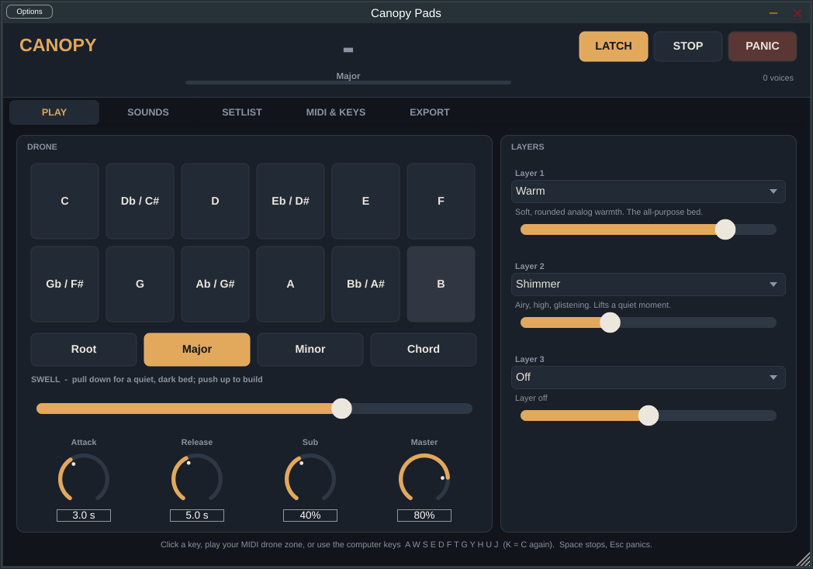
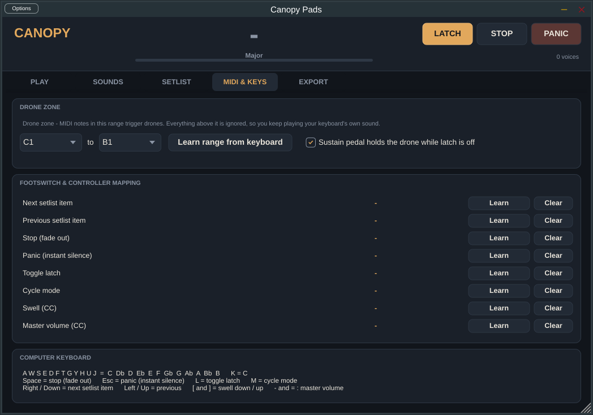
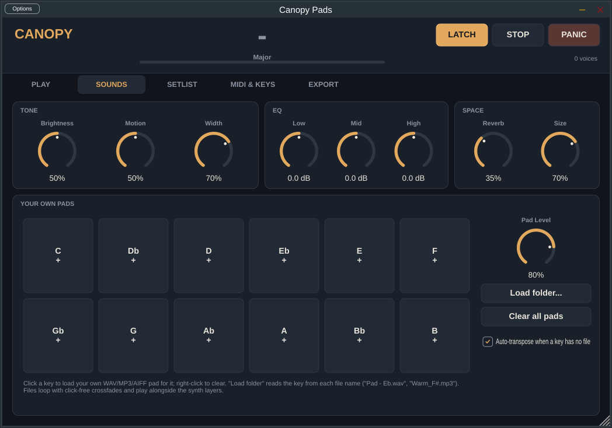
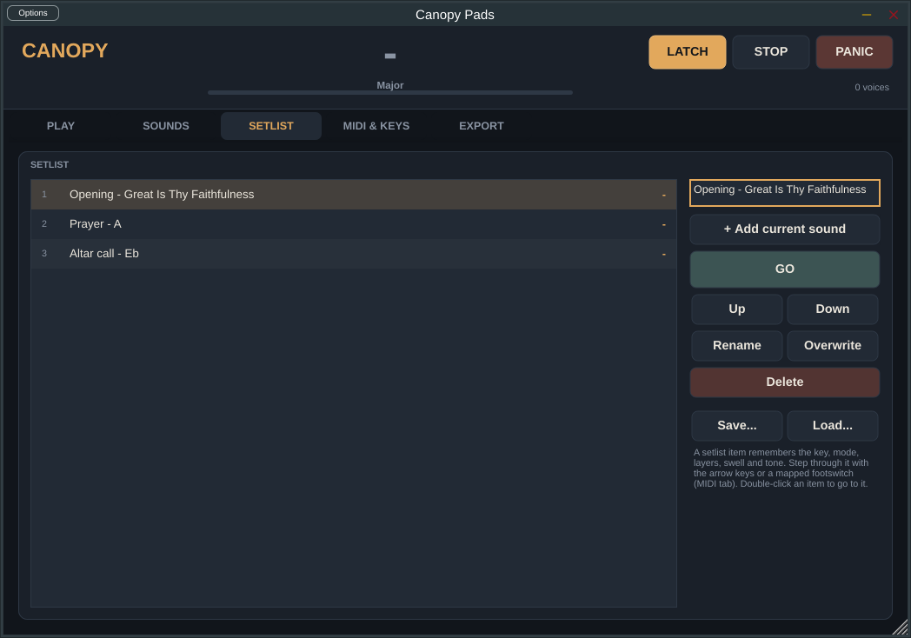

<p align="center">
  
</p>

<h1 align="center">Canopy Pads</h1>
<p align="center"><b>Ambient drone pads for church musicians. Press one key. Keep playing.</b></p>
<p align="center">
  Free &nbsp;·&nbsp; Mac + Windows &nbsp;·&nbsp; AU (MainStage / Logic) &nbsp;·&nbsp; VST3 (Ableton, Studio One, Reaper…) &nbsp;·&nbsp; Standalone app
</p>
<p align="center">
  <a href="https://github.com/jctagbor/canopy-pads/releases/latest"><b>⬇ Download the latest release</b></a>
</p>

---

You're on keys. The pastor is praying. You need a warm bed of sound under the moment — but you also need both hands for the piano. Canopy fixes that: play one note in the bottom octave of your keyboard and an evolving pad starts and **stays** while you play above it. Play another low note to change key. That's it.

No dragging MP3 files into a session. No fiddling with a laptop mid-service. One key.

## Hear it

Three of the eight built-in pad engines, in E♭ (straight out of Canopy's own export, nothing added):

| Warm | Ocean | Choir |
|---|---|---|
| [▶ Warm – Eb](docs/media/Canopy%20Warm%20-%20Eb%20maj.mp3) | [▶ Ocean – Eb](docs/media/Canopy%20Ocean%20-%20Eb%20maj.mp3) | [▶ Choir – Eb](docs/media/Canopy%20Choir%20-%20Eb%20maj.mp3) |

## Install (2 minutes)

**Mac** — download `Canopy-Pads-…-mac.dmg` from [Releases](https://github.com/jctagbor/canopy-pads/releases/latest), open it, double-click the installer. It puts the app in Applications and the AU + VST3 plugins where MainStage, Logic and Ableton look for them. Works on Apple Silicon and Intel, macOS 11 and up.

> macOS will say it "cannot verify the developer" the first time — this is a free community build, not a $99/year Apple-signed one. **Right-click the installer → Open → Open.** Once.

**Windows** — download `Canopy-Pads-…-windows-setup.exe`, run it. Installs the app and the VST3. Windows 10/11, 64-bit.

Then restart your music software.

## Use it in MainStage

1. Add a **Software Instrument** channel strip.
2. Instrument slot → **AU Instruments → Tagbor Audio → Canopy Pads**.
3. Open the plugin → **MIDI & Keys** tab → set the **drone zone** (default is C1–B1, the bottom octave of an 88-key board). Notes in the zone trigger pads; everything above is ignored, so your piano strip keeps working. Or click **Learn range from keyboard** and play the lowest and highest key you want.
4. Optional but great: put a footswitch on **Next setlist item** and an expression pedal on **Swell** (both via **Learn** on the same tab).

<p align="center"></p>

If Canopy doesn't appear in the AU list: quit MainStage, log out and back in once (macOS caches the plugin list).

## Use it in Ableton / Studio One / Reaper / FL Studio

Add **Canopy Pads** (VST3, Tagbor Audio) as an instrument on a MIDI track, arm the track, play. Set the drone zone the same way. Every knob is automatable.

## Use it on its own

Open **Canopy Pads**. Click **Options** (top-left) to choose your audio interface and MIDI keyboard. No keyboard? The laptop keys work:

`A W S E D F T G Y H U J` = C through B &nbsp;·&nbsp; **Space** stop &nbsp;·&nbsp; **Esc** panic &nbsp;·&nbsp; **L** latch &nbsp;·&nbsp; **M** mode &nbsp;·&nbsp; **← →** setlist &nbsp;·&nbsp; **[ ]** swell

## What's inside

| | |
|---|---|
| **Drone modes** | Root · Major · Minor · **Chord** (hold any chord in the zone — it drones the chord, not just the root) |
| **8 pad engines** | Warm · Shimmer · Dark · Glass · Choir · Strings · Organ · Ocean, plus a Sub layer |
| **Layering** | Stack up to 3 engines with their own levels — Warm + Shimmer + a little Choir |
| **Your own pads** | Load WAV / MP3 / AIFF pads per key; they loop click-free alongside the synth; missing keys are auto-transposed |
| **Swell** | One control that opens the tone *and* raises the level — map it to an expression pedal and build a prayer moment with your foot |
| **Tone** | Brightness · Motion (how much the pad moves) · Width · 3-band EQ · Reverb |
| **Crossfades** | Every key change blends smoothly; attack 0.1–20 s, release 0.1–30 s |
| **Setlist** | Save named items (key + mode + layers + tone), step through with arrows or a footswitch, save/load as a file |
| **MIDI learn** | Any pedal or knob → Next / Previous / Stop / Panic / Latch / Mode / Swell / Volume |
| **Sustain pedal** | Holds the drone while latch is off |
| **Export** | Render any key, or all 12, as 24-bit WAV pads for use anywhere |

<p align="center"></p>

### Recipes

- **Sunday bed** — Layer 1 Warm 80%, Layer 2 Shimmer 35%, Sub 40%, Reverb 35%, Major, Swell 70%
- **Prayer / altar call** — Dark 70% + Ocean 50%, Sub 55%, Motion 70%, Reverb 55%, Swell 30% → ride Swell up with the pedal
- **Hymn** — Choir 75% + Strings 40%, Brightness 55%, Chord mode, drone zone widened to C1–B2, hold the chord there
- **Your own pads underneath** — Sounds tab → *Load folder* with files named like `Pad - Eb.wav`; Pad Level 70%, synth layers down to taste

## Setlists travel

Setlists save as a small `.json` (Setlist tab → Save…). Email it or drop it in a cloud folder and load it on the other machine. Everything else (layers, tone, mappings, pad files) saves inside your MainStage concert or Ableton set, like any plugin.

<p align="center"></p>

## Build it yourself

C++17 / [JUCE 8](https://juce.com). Band-limited wavetable oscillators with anti-aliasing mip levels, per-pitch state-variable filters with slow stochastic modulation, equal-power envelope crossfades, chorus/formant buses, 3-band EQ, algorithmic reverb, brick-wall limiter. ~1–2% of a CPU core per voice.

```
cmake -B build -DCMAKE_BUILD_TYPE=Release
cmake --build build -j8
```

JUCE is fetched automatically. `cmake --build build --target canopy_test` runs the headless test-suite (latch/held behaviour, sustain pedal, chord mode, MIDI learn, setlist, state round-trip, sample loading). Releases are built by [GitHub Actions](.github/workflows/release.yml) — the Mac DMG and Windows installer attached to each release come straight from that pipeline.

```
Source/
  DroneEngine.*      synthesis engine, voices, bus FX
  Styles.h           the 8 pad recipes — add your own; it's a table
  Wavetable.h        band-limited oscillators
  SampleLayer.*      user pad files, looping, auto-transpose
  Exporter.*         offline WAV rendering
  PluginProcessor.*  parameters, MIDI (zone, latch, chord, learn), setlist, state
  PluginEditor.*     the UI
```

## Troubleshooting

- **"Canopy Pads is damaged / can't be opened" (Mac)** — right-click → Open. If it persists: `xattr -dr com.apple.quarantine "/Applications/Canopy Pads.app"` in Terminal.
- **No sound in the standalone app** — Options → check output device and sample rate. Default drone zone is C1–B1; on a 61-key board that's below the lowest key, so set the zone (MIDI & Keys).
- **Pads retrigger when I play chords** — you're in Root/Major/Minor and hitting several zone notes. Use **Chord** mode, or play single bass notes in the zone.
- **A pad file won't load** — WAV, AIFF, MP3, FLAC or OGG, under 10 minutes.

## License

MIT — free for churches, musicians, and anyone else. If Canopy carries a service for you, [tell me about it](https://github.com/jctagbor/canopy-pads/discussions).

<p align="center"><sub>Made by John Carl Tagbor · Tagbor Audio</sub></p>
